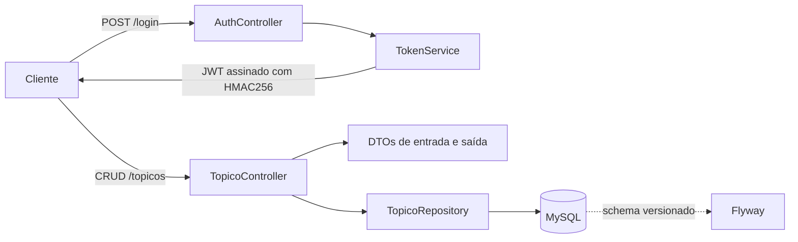

# Estudo de caso — ForumHub

**Stack:** Java 17 · Spring Boot · Spring Data JPA · MySQL · Flyway · JWT  
**Código:** https://github.com/GilvamOliveira/forumhub

## Contexto

ForumHub é uma API REST de fórum construída para praticar modelagem de domínio, camadas de aplicação e persistência com Java e Spring Boot. O projeto nasceu como um desafio de curso e foi organizado para parecer e funcionar como um serviço pequeno, com endpoints claros, DTOs, migrations e configuração por ambiente.

## Problema

Um fórum precisa evitar tópicos duplicados, manter uma listagem estável e permitir que cada tópico seja consultado, atualizado e removido. O desafio também pedia autenticação por token, o que trouxe a necessidade de separar a emissão do JWT da sua validação nas requisições.

## Escopo entregue

| Método | Rota | Função |
| --- | --- | --- |
| `POST` | `/login` | Emite um JWT a partir do login informado |
| `POST` | `/topicos` | Cadastra um tópico, bloqueando título + mensagem duplicados |
| `GET` | `/topicos` | Lista os tópicos cadastrados |
| `GET` | `/topicos/{id}` | Detalha um tópico |
| `PUT` | `/topicos/{id}` | Atualiza título, mensagem e curso |
| `DELETE` | `/topicos/{id}` | Remove um tópico |

O modelo `Topico` registra título, mensagem, autor, curso, status e data de criação. O status inicial é `ABERTO`, e a data é preenchida no momento da criação.

## Arquitetura

- `controller`: recebe a requisição e coordena o caso de uso.
- `dto`: separa o contrato da API das entidades JPA.
- `repository`: acesso a dados via Spring Data JPA.
- `model`: entidade `Topico` e regra de atualização.
- `security`: geração do token JWT.
- `db/migration`: criação da tabela via Flyway.

## Decisões técnicas

1. **DTOs em vez de expor a entidade.** `DadosCadastroTopico`, `DadosAtualizacaoTopico` e `DadosListagemTopico` deixam o contrato explícito e evitam acoplar a API ao modelo de persistência.
2. **Duplicidade no cadastro.** `existsByTituloAndMensagem` bloqueia o caso mais óbvio de repetição antes de salvar. A regra é simples, mas resolve o requisito principal sem uma consulta complexa.
3. **Flyway para o schema.** A tabela é criada por migration versionada, em vez de depender de `ddl-auto`. Isso torna o ambiente reproduzível e prepara o projeto para evoluções de schema.
4. **JWT com `java-jwt`.** O token é assinado com HMAC256, tem issuer `forumhub` e expiração de 24 horas. O segredo vem de `JWT_SECRET`, fora do código.
5. **Configuração por ambiente.** Banco e segredo são lidos de `DB_URL`, `DB_USERNAME`, `DB_PASSWORD` e `JWT_SECRET`, com valores padrão apenas para o banco local.

## Segurança: o que está pronto e o que falta

O projeto **emite** um JWT, mas ainda não fecha o ciclo de autenticação:

- O endpoint `/login` recebe login e senha, porém o `TokenService` apenas assina o token; a senha não é verificada.
- `SecurityFilter` e `SecurityConfigurations` estão vazios: não existe filtro para ler o `Authorization: Bearer`, validar a assinatura e popular o contexto.
- Não há autorização por perfil nem proteção explícita das rotas de tópicos no fluxo JWT.

Esse limite está documentado de propósito. O valor do projeto está no que já funciona — API, CRUD, validação, persistência e migrations — e o próximo passo é transformar a emissão do token em autenticação de fato.

## Testes e qualidade

- Teste de contexto com `@SpringBootTest` para verificar a inicialização da aplicação.
- Validação de entrada com Bean Validation nos DTOs de cadastro.
- Migrations versionadas com Flyway.
- Configuração de banco e segredo JWT por variáveis de ambiente.

## Desafios

- **Modelar o contrato sem vazar a entidade.** A separação em DTOs exigiu mapear entrada e saída, mas deixou a API mais previsível.
- **Tratar duplicidade sem banco rico em regras.** A checagem explícita no controller resolve o requisito atual; uma restrição composta no banco seria a evolução natural.
- **Preparar JWT sem implementar segurança pela metade.** Era melhor documentar o estágio real do que apresentar uma proteção que não existe.

## Próximos passos

- Implementar `SecurityFilter` para validar o JWT e autenticar a requisição.
- Verificar credenciais no login com senha hash e usuários persistidos.
- Adicionar autorização por perfil (autor, moderador, admin).
- Cobrir os endpoints com testes de integração e cenários de erro.
- Adicionar paginação na listagem e documentação OpenAPI.
- Padronizar respostas de erro com `@ControllerAdvice`.
